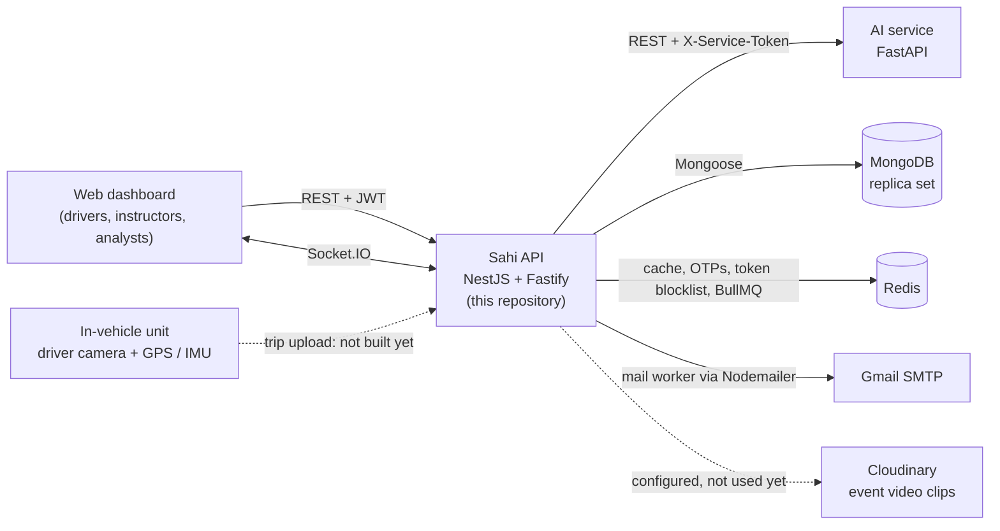
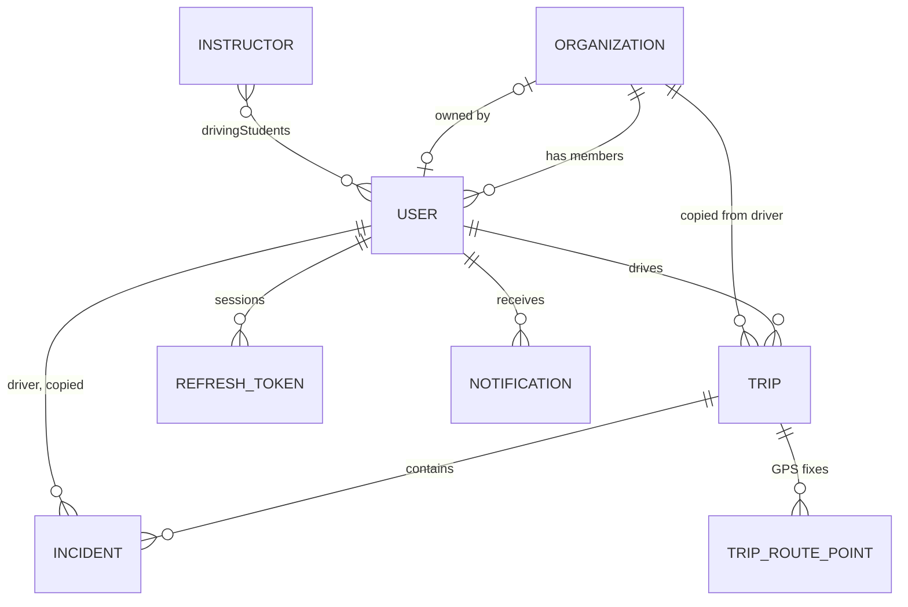
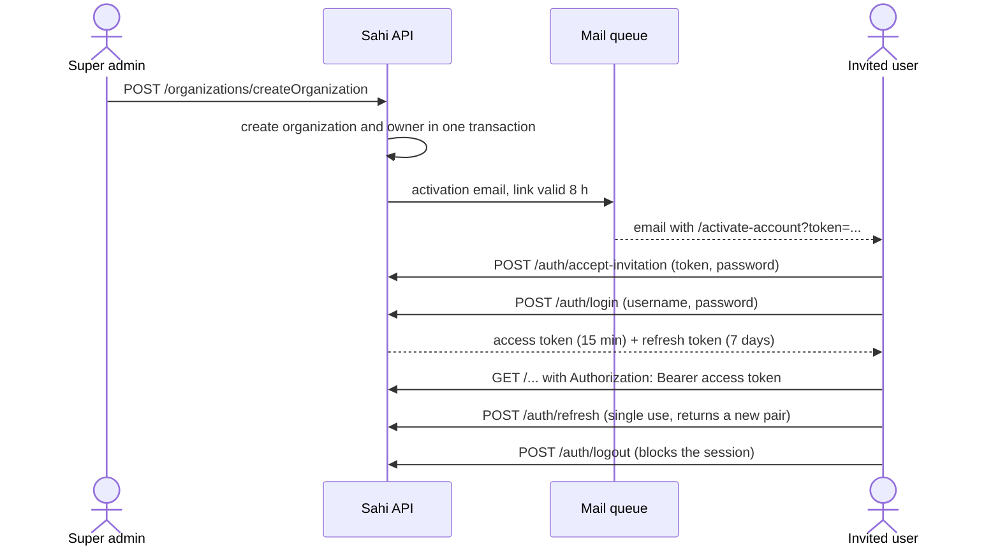

# Sahi — Driver Monitoring & Evaluation System (Backend API)

This is the backend of **Sahi**, a graduation project that watches drivers during a trip. It looks at what the vehicle does (harsh braking, speeding, poor lane keeping, …) and what the driver does (distraction, phone use, drowsiness, eye closure). Each trip gets a score, and drivers, driving instructors and analysts get dashboards, an interactive trip map and PDF reports.

The API is built with **NestJS 12 on Fastify**, stores data in **MongoDB**, and uses **Redis** for caching, one-time secrets and background jobs. It talks to a separate **FastAPI** AI service for coaching content.

> **Status as of 2026-11-12:** most of the *read side* is built: authentication, driver dashboards, the trip map, PDF reports and notifications storage. The *write side* is not built yet. There is no way to send trips, GPS points or incidents from the vehicle or the AI service, and no code computes trip scores. Today the data comes only from the seed scripts. See [Project status](#9-project-status) for the full list of what is done and what is left.

---

## Contents

1. [What the system does](#1-what-the-system-does)
2. [System architecture](#2-system-architecture)
3. [Domain concepts and business rules](#3-domain-concepts-and-business-rules)
4. [Data model](#4-data-model)
5. [Authentication and security](#5-authentication-and-security)
6. [API reference](#6-api-reference)
7. [Getting started](#7-getting-started)
8. [Scripts, testing and Docker](#8-scripts-testing-and-docker)
9. [Project status](#9-project-status)
10. [Conventions for contributors](#10-conventions-for-contributors)

---

## 1. What the system does

| Area | What it gives the user |
| --- | --- |
| **Driver main dashboard** | Totals (trips, distance, driving time), last trip score compared with the recent average, the 6 most recent trips, and the 5 incidents that cost the most points in the last 60 days |
| **Trips list** | The driver's trips with filters (status, event type, date range) and pagination, each with its incidents |
| **Trip report** | Overall stats, header, statistics, detected events, incident counts per type, points lost per type, and speed, acceleration and steering graphs |
| **Trip map** | The GPS route coloured by speed against the limit (within, near, over, unknown), incident markers, and a timeline split into *driving actions* and *driver states* |
| **My progress** | Recent average, change since the first trips, long-term average, best trip, score history graph, where points are lost, event mix |
| **PDF report** | A driver performance report in **English or Arabic (RTL)** |
| **Coaching** | Coaching tips, what went well, what to improve and recommendations, proxied from the FastAPI AI service |
| **Notifications** | Notifications stored per user, read through a Socket.IO gateway (list, unread, mark as read) |
| **Organizations** | Driving schools, fleet companies and insurance companies, each with an owner and employees |
| **Accounts** | Invitation-only onboarding, login, token refresh, logout, logout everywhere, password reset by email OTP, forced password change |

### Roles

Each user has one role. The role an owner or employee gets depends on the organization type (`OWNER_ROLES` / `EMPLOYEE_ROLES` in `src/modules/organizations/organizations.enum.ts`).

| Role | Belongs to | State today |
| --- | --- | --- |
| `super_admin` | — | Invites users, creates organizations, revokes sessions. **Passes every role check.** |
| `driver` | Driving school (learner) or fleet company | Main user of the dashboards, map, reports and coaching |
| `driver_instructor` | Driving school (employee) | Has a `drivingStudents` list (Mongoose discriminator). Only one endpoint so far (`/incidents/recentCounts`). |
| `school_administrator` | Driving school (owner) | Assigned on organization creation. Marked *Future Work*; no endpoints. |
| `fleet_analyst` | Fleet company (employee) | Can open their organization's trip maps. No dedicated dashboards yet. |
| `fleet_manager` | Fleet company (owner) | *Future Work* |
| `insurance_analyst` | Insurance company (employee) | Can open their organization's trip maps. No dedicated dashboards yet. |
| `insurance_manager` | Insurance company (owner) | *Future Work* |

---

## 2. System architecture

### 2.1 System context



Dashed lines are parts of the design that are not built yet.

### 2.2 Tech stack

| Concern | Choice |
| --- | --- |
| Runtime | Node.js 24 (Docker image). Bun 1.x installs packages and runs scripts. |
| Framework | NestJS 12 on the Fastify 5 adapter |
| Language / build | TypeScript 6, compiled with SWC (`nest build`, `"builder": "swc"`) |
| Database | MongoDB 8 through Mongoose 9 (transactions use `AsyncLocalStorage`) |
| Cache | `@nestjs/cache-manager` + Keyv Redis store |
| Background jobs | BullMQ on Redis (mail queue) |
| Validation | Zod 4 through Nest's `StandardSchemaValidationPipe`. The same Zod schemas validate environment variables and generate Swagger docs. |
| API docs | Swagger UI at **`/api`** |
| Auth | JWT access tokens (HS256), rotating opaque refresh tokens, argon2 password hashing |
| Real time | Socket.IO gateway (`@nestjs/websockets`) |
| Email | Nodemailer (Gmail) |
| PDF | `pdfmake-rtl` with the Roboto and Cairo fonts (English and Arabic) |
| Scheduling | `@nestjs/schedule` |
| Rate limiting | `@nestjs/throttler` |
| Tests | Vitest 4, `@nestjs/testing`, supertest |
| Lint / format | oxlint, Prettier |

### 2.3 Module structure

```mermaid
flowchart TB
    App[AppModule]
    App --> Cfg["AppConfigModule<br/>.env loading + Zod validation"]
    App --> Infra[InfrastructureModule]
    App --> Core[CoreModule]
    App --> Feat[FeaturesModule]

    Infra --> DB["DatabaseModule<br/>Mongoose"]
    Infra --> Cache["AppCacheModule<br/>Redis, global CacheService"]
    Infra --> Queue["QueueModule<br/>BullMQ connection"]

    Core --> Mail["MailModule<br/>queue + worker"]
    Core --> Sched[ScheduleModule]
    Core --> Thr["ThrottlerModule<br/>global guard, 60 req/min"]
    Core --> Pipe["Global validation pipe"]
    Core --> Ev["EventEmitterModule<br/>set up, unused"]

    Feat --> Auth["Auth<br/>tokens, OTP, guards"]
    Feat --> Users
    Feat --> Orgs[Organizations]
    Feat --> Instr[Instructors]
    Feat --> Trips["Trips + Trip map"]
    Feat --> Inc[Incidents]
    Feat --> Notif["Notifications<br/>Socket.IO"]
    Feat --> Rep["Reports<br/>PDF"]
    Feat --> Fast["FastApi<br/>AI proxy"]
```



### 2.4 How a request is handled

1. **Fastify** receives the request. The app listens on `0.0.0.0:${PORT}`.
2. **Global guards** run for every route:
   - `ThrottlerGuard` allows 60 requests per minute per client IP. Sensitive auth routes are limited to 5 per minute with `@Throttle`.
   - `AuthenticationGuard` checks the Bearer JWT, the Redis blocklist, the user's security stamp, that the account is active, and that no password change is pending. Routes marked `@Public()` skip it.
   - `RolesGuard` applies `@AllowedRoles([...])`. Super admins always pass. A user with the wrong role gets **404**, not 403, so the route's existence is not revealed.
3. The **validation pipe** checks `@Body / @Query / @Param({ schema })` against Zod schemas.
4. **Controller → Service → Repository → Mongoose model.** Each repository extends the generic `BaseRepository<T>`.
5. Most routes return `{ message, data }`. Some older routes return `{ success, data }` (see [Tech debt](#tech-debt-and-cleanup)).

### 2.5 Folder layout

```
src/
├── main.ts                    # bootstrap: Fastify adapter, Swagger, listen
├── app.module.ts              # root module
├── config/                    # env loading (registerAs namespaces), ConfigNames enum, Zod env schema
├── core/                      # cross-cutting: mail queue + worker, Swagger setup, throttler, validation pipe
├── infrastructure/            # MongoDB, Redis cache (CacheService), BullMQ connection
├── common/                    # decorators (@Public, @AllowedRoles, @CurrentUser, @CurrentSession),
│                              # enums, Zod field schemas, BaseRepository, response interfaces, helpers
├── shared/                    # TransactionService (Mongo transactions), interceptors/filters (not registered yet)
├── database/scripts/          # seed.ts, seed-organizations.ts, seed-super-admin.ts
└── modules/
    ├── auth/                  # controller, service, guards, hashing, otp, token/{access,refresh,one-time,jwt}
    ├── users/                 # User model, self-service endpoints
    ├── organizations/         # Organization model, create org + invite owner/employee
    ├── instructors/           # Instructor discriminator (drivingStudents)
    ├── trips/                 # Trip + TripRoutePoint models, dashboards, trip map, scoring helpers
    ├── incidents/             # Incident model, dashboard aggregations
    ├── notifications/         # Notification model, Socket.IO gateway
    ├── reports/               # PDF generation (EN / AR)
    └── fast-api/              # proxy to the FastAPI AI service
test/                          # e2e tests (vitest.config.e2e.ts)
```

Path aliases (see `tsconfig.paths.json`): `@modules`, `@common`, `@shared`, `@config`, `@infrastructure`, `@database`, `@Core`, `@Cache`.

---

## 3. Domain concepts and business rules

### 3.1 Trips

- **Lifecycle** (`TripStatus`): `planned → recording → uploading → processing → completed`, or `failed`. *The enum exists, but no code moves a trip between these states yet.*
- `startedAt` holds the planned start while the trip is `planned`, and the actual start once recording begins.
- Measurements (`durationSeconds`, `distanceKm`, `averageSpeedKmh`, `topSpeedKmh`, `eventsCount`) and `score` stay **`null` until the trip is processed**. A planned trip therefore shows "—" instead of 0 and does not pull averages down.
- Each trip copies `organization` from its driver, so an organization's trips can be listed with one query.
- **Score** = 100 − the sum of `pointsDeducted` of the trip's counted incidents. *This rule is documented on the model, but no code computes it yet.*
- **Risk** (SRS §8.5) is a virtual derived from the score: **≥ 85 low**, **65–84 medium**, **< 65 high**.
- **Long-term score** (SRS §8.4) is the mean of trip scores weighted by `duration × exp(−age / 30 days)`. It is implemented as `longTermScore()` in `trips/trip-scoring.ts` but **not used yet**: the progress endpoints and the PDF use a plain `$avg`.
- Motion signals for the graphs (`tripSpeeds`, `tripAccelerations`, `steeringWheelAngle`) are arrays stored on the trip document.

### 3.2 Incidents

| Type | Timeline row (`IncidentCategory`) |
| --- | --- |
| `harsh_braking`, `harsh_acceleration`, `speeding`, `poor_lateral_control`, `unsafe_following_distance` | `driving_action` (what the vehicle did) |
| `distraction`, `phone_usage`, `drowsiness`, `eye_closure` | `driver_state` (what the camera saw) |

- Severity is `low`, `medium` or `high`.
- `pointsDeducted` is stored as a positive number; the UI shows it as negative.
- `location` (WGS84) is `null` when no GPS fix was recorded. Such an incident still appears on the timeline, but not on the map.
- `speedKmh` is nullable. `clipUrl` / `clipPublicId` point to a short Cloudinary clip (intended to be deleted after 90 days).
- Each incident copies `driver` from its trip, so a driver's incidents can be queried directly.

### 3.3 Trip map

- **Speed category per GPS point:** `within_limit` (speed ≤ limit), `near_limit` (at most **10 %** over), `over_limit`, or `unknown` when the speed or the limit is missing. A gap in the readings is never shown as safe driving.
- **Speed limit source:** the limit recorded for that point (`route`), otherwise the trip-wide limit set when the trip was planned (`trip`), otherwise `null`.
- **Segments:** runs of consecutive points with the same category, returned as index ranges so the client draws one polyline per colour.
- **Downsampling:** about `maxPoints` points are returned (default 2,000, maximum 10,000). Points where the colour changes are always kept. Points are streamed from a Mongo cursor, so a long trip is never fully in memory.
- **Visibility** (`trip-access.ts`):
  - Super admins can see every trip.
  - A driver can see only their own trips.
  - Staff can see trips of their organization(s).
  - Anyone else gets the same 404 as for a missing trip, so trip ids cannot be probed.

### 3.4 Organizations and onboarding

- There are three organization types: `driving_school`, `fleet_company` and `insurance_company`.
- A super admin creates an organization and its owner **in one transaction**. The owner's role comes from `OWNER_ROLES`.
- Employees invited into an organization get a role from `EMPLOYEE_ROLES`: instructor, fleet analyst or insurance analyst.
- Users are **invitation-only**. An invited user is created with a random, unusable password and status `waiting_for_activation`, and is emailed a single-use activation link: `${APP_CLIENT_URL}/activate-account?token=…`, valid for 8 hours.
- Usernames are generated from the email address: `jane.doe@mail.com` becomes `jane-doe-k3x9q` (a slug plus 5 random characters, retried if taken).

---

## 4. Data model



### MongoDB collections

| Collection | Model | Key fields | Indexes / notes |
| --- | --- | --- | --- |
| `users` | `User` (+ `Instructor` discriminator on `role`) | `username` (unique, lowercase), `fullName`, `email`, `passwordHash`, `securityStamp`, `role`, `status`, `organization`, `mustChangePassword`, `language` (`en`/`ar`), `deletionRequestedAt`, `age`, `gender`. Instructors also have `drivingStudents[]`. | unique `{email, organization}` |
| `organizations` | `Organization` | `name`, `organizationType`, `organizationOwner` | unique `{name, organizationOwner}`, case-insensitive, only when an owner is set. Virtuals `organizationEmployees`, `organizationDrivers`. |
| `trips` | `Trip` | `code` (e.g. `T-24013`, unique), `driver`, `organization`, `vehicle`, `status`, `startedAt`, `speedLimitKmh`, measurements, `score`, motion signal arrays | `{driver, startedAt:-1}`, `{organization, startedAt:-1}`. Virtuals `risk` and `incidents` (autopopulated). |
| `triproutepoints` | `TripRoutePoint` | `trip`, `recordedAt`, `latitude`, `longitude`, `speedKmh`, `speedLimitKmh`, `headingDeg` | unique `{trip, recordedAt}`. A separate collection, because a 90-minute trip at 1 Hz is about 5,400 points. |
| `incidents` | `Incident` | `trip`, `driver`, `type`, `severity`, `occurredAt`, `location`, `speedKmh`, `pointsDeducted`, `clipUrl`, `clipPublicId` | `{driver, occurredAt:-1}` |
| `refreshtokens` | `RefreshToken` | `_id` = session id (`sid`), `tokenHash` (unique), `userId`, `securityStamp`, `expiresAt` | TTL index on `expiresAt`, plus a daily cleanup cron at 03:00 |
| `notifications` | `Notification` | `recipient`, `type` (`trip_report_ready`, `high_risk_event`, `system_update`), `trip`, `incident`, `params` (values for the localized message), `readAt` | `{recipient, createdAt:-1}`, `{recipient, readAt, createdAt:-1}` |

### Redis keys

| Key | Value | Lifetime |
| --- | --- | --- |
| `otp:<purpose>:<userId>` | HMAC-SHA256 of the OTP, attempt count, expiry | `OTP_EXPIRY_MINUTES` (default 5) |
| `one_time_token:<purpose>:<sha256(token)>` | user id | 15 min (forced password change), 8 h (account activation) |
| `blocked_access_token:<sid>` | `true` (set on logout) | the rest of the access token's lifetime |
| `incidents:type-counts:21d` | incident counts by type over 21 days | 10 min |
| BullMQ queue `mail` | email jobs | removed once sent; failed jobs kept for 1 day |

---

## 5. Authentication and security

### 5.1 Onboarding and session flow



### 5.2 Token design

- **Access token:** a JWT signed with HS256. Issuer is `sahi-api`, audience is `sahi-web`, lifetime is `JWT_ACCESS_TOKEN_TTL_MINUTES` (default 15). Claims are `sid`, `userId` and `securityStamp`. The claims are checked against a Zod schema after the signature is verified.
- **Refresh token:** 64 random bytes. Only its SHA-256 hash is stored, with `_id` = `sid`. It is **single use**: each refresh swaps the hash in one atomic compare-and-swap, so two parallel refreshes cannot both succeed. Its lifetime is `JWT_REFRESH_TOKEN_TTL_DAYS` (default 7).
- **Security stamp:** an ObjectId on the user. It is rotated on every password change, password reset and "log out everywhere", which immediately invalidates all older access tokens.
- **Logout:** puts the session id in a Redis blocklist until its access token would have expired, and deletes the refresh token.
- **One-time tokens** (activation, forced password change): 32 random bytes. They are stored in Redis under their SHA-256 hash and consumed atomically.

### 5.3 Security measures in place

| Measure | Where |
| --- | --- |
| argon2 password hashing. Passwords are 12–128 characters and never trimmed. | `hashing.service.ts`, `password.schema.ts` |
| Login takes the same time whether or not the username exists (a dummy hash is checked) | `auth.service.ts` |
| Forgot-password always answers 200, so it does not reveal whether an account exists | `auth.service.ts` |
| 6-digit OTPs are stored as an HMAC (never in plain text), compared in constant time, deleted after 5 wrong guesses, and work only once | `otp.service.ts` |
| A super admin changing their password needs an extra email OTP (two-step) | `auth.service.ts` |
| Rate limiting: 60/min globally, 5/min on login, reset, invitation and password routes | `core.module.ts`, `auth.controller.ts` |
| A forced password change blocks all routes until it is done | `authentication.guard.ts` |
| Wrong role → 404, and a trip the user may not see → 404 | `roles.guard.ts`, `trip-map.service.ts` |
| Strict Zod objects reject unknown fields | most DTOs (`z.strictObject`) |
| Email jobs are deleted from Redis once sent, so OTPs and links do not linger | `mail.constant.ts` |

The known security gaps are listed in [Project status → Security](#p1--security-gaps).

---

## 6. API reference

Interactive docs: **`http://localhost:3000/api`** (Swagger UI; use the *Authorize* button with an access token).

Legend for the Access column:
- **Public**: no token needed.
- **User**: any logged-in user.
- A role name means only that role (super admins pass every role check).
- ⚠️ marks a route that should not be public (see the roadmap).

### Auth — `/auth`

| Method | Path | Access | Purpose |
| --- | --- | --- | --- |
| POST | `/auth/login` | Public, 5/min | Log in with username and password. Returns tokens and the user, or `passwordChangeRequired` with a `passwordChangeToken`. |
| POST | `/auth/refresh` | Public | Exchange a refresh token for a new token pair (single use) |
| POST | `/auth/forced-change-password` | Public, 5/min | Set a new password using the `passwordChangeToken` |
| POST | `/auth/accept-invitation` | Public, 5/min | Activate an invited account with the emailed token |
| POST | `/auth/forgot-password` | Public, 5/min | Email a reset OTP to the account with this username |
| POST | `/auth/reset-password/validate` | Public, 5/min | Check a reset OTP (see the known bug in the roadmap) |
| POST | `/auth/reset-password` | Public, 5/min | Reset with username, OTP and new password. Ends all sessions. |
| PATCH | `/auth/change-password` | User, 5/min | Change your own password. Super admins call it twice: once without `otp` to receive one by email, then with it. |
| POST | `/auth/logout` | User | End the current session (204) |
| GET | `/auth/me` | User | The logged-in user |
| POST | `/auth/invite` | `super_admin` | Invite a user with any role into any organization |
| DELETE | `/auth/users/:id/sessions` | `super_admin` | Log a user out of every device |

### Users — `/users`

| Method | Path | Access | Purpose |
| --- | --- | --- | --- |
| PATCH | `/users/me/full-name` | User | Change the name shown to evaluators and in reports |
| POST | `/users/me/deletion-request` | User | Record a request to delete the account (the first date is kept) |
| GET | `/users/me/organizations` | User | The organization id(s) of the logged-in user |
| GET | `/users/getAllUsers?role=` | ⚠️ Public | List users, optionally filtered by role (not paginated) |

### Organizations — `/organizations`

| Method | Path | Access | Purpose |
| --- | --- | --- | --- |
| GET | `/organizations/getAllOrganizations` | ⚠️ Public | List organizations, sorted by name |
| POST | `/organizations/createOrganization` | `super_admin` | Create an organization and invite its owner |
| POST | `/organizations/:organizationId/inviteEmployee` | ⚠️ Public | Invite an employee. The role depends on the organization type. |

### Driver dashboards — `/trips`, `/incidents`

All routes in this section need the `driver` role.

| Page | Method | Path | Returns |
| --- | --- | --- | --- |
| Main dashboard | GET | `/trips/me/totals` | Completed trips, distance, driving time, last trip score and its difference from the last-5 average |
| Main dashboard | GET | `/trips/me/recent` | The 6 latest scored trips |
| Main dashboard | GET | `/incidents/significant` | The 5 costliest incidents in the last 60 days |
| Trips list | GET | `/trips/filteredTrips/:driverId?status&eventType&from&to&page&limit` | Filtered, paginated trips (newest first) with their incidents |
| Trip report | GET | `/trips/tripOverall/:tripId` | Duration, distance, speeds, events, score, risk |
| Trip report | GET | `/trips/tripReportHeader/:tripId` | Start time, duration, vehicle, driver name |
| Trip report | GET | `/trips/tripStatistics/:tripId` | Duration, distance, average and top speed, events |
| Trip report | GET | `/trips/detectedEvents/:tripId` | Incidents: type, severity, time, points |
| Trip report | GET | `/trips/incidentsCount/:tripId` | Count per incident type (0 for types that did not happen) |
| Trip report | GET | `/trips/incidentAnalysis/:tripId` | Count and total points lost per type |
| Trip report | GET | `/incidents/trip/:tripId?limit` | The trip's incidents, most points deducted first |
| Trip report | GET | `/trips/speedMotionGraph/:tripId` | Speed over time |
| Trip report | GET | `/trips/accelerationMotionGraph/:tripId` | Acceleration over time |
| Trip report | GET | `/trips/steeringMotionGraph/:tripId` | Steering wheel angle over time |
| My progress | GET | `/trips/progressDetails/:driverId` | Recent average, change since start, long-term average, best trip |
| My progress | GET | `/trips/progressGraph/:driverId` | Score history (date, score) |
| My progress | GET | `/incidents/tripIncidentsCount/:driverId` | Where points are lost: count and points per type, all time |
| My progress | GET | `/incidents/eventMix/:driverId` | Event count per type, all time |

### Trip map — `/trips/:tripId/...`

These routes are open to any logged-in user, with the visibility rules from [3.3](#33-trip-map).

| Method | Path | Purpose |
| --- | --- | --- |
| GET | `/trips/:tripId/map?maxPoints` | Everything in one call: trip summary, route, segments, incident markers, the two timeline rows, metadata |
| GET | `/trips/:tripId/route?from&to&maxPoints` | The route only, optionally for a time window |
| GET | `/trips/:tripId/incidents?eventType&severity` | Incident markers only, optionally filtered |

### Instructors, reports and AI

| Method | Path | Access | Purpose |
| --- | --- | --- | --- |
| GET | `/incidents/recentCounts` | `driver_instructor` | Incident counts by type over the last 21 days (all drivers, cached for 10 min) |
| GET | `/reports/downloadReport?language=en\|ar` | `driver` | The driver's performance report as a PDF (shown inline) |
| GET | `/fast-api/health-check` | Public | Checks that the FastAPI service is up |
| GET | `/fast-api/coachingTips` | `driver` | Proxied from FastAPI `/coach/coachingTips` |
| GET | `/fast-api/whatWentWell` | `driver` | Proxied from `/coach/whatWentWell` |
| GET | `/fast-api/whatToImprove` | `driver` | Proxied from `/coach/whatToImprove` |
| GET | `/fast-api/recommendations` | `driver` | Proxied from `/coach/recommendations` |
| GET | `/` | User | Hello-world check |

### WebSocket (Socket.IO) — notifications

The gateway uses the default namespace on the same port as the API. Connect with the access token:

```ts
import { io } from 'socket.io-client';
const socket = io('http://localhost:3000', { auth: { token: `Bearer ${accessToken}` } });

socket.emit('findAllUnreadUserNotifications', null, (response) => console.log(response));
```

| Event (client → server) | Payload | Answer |
| --- | --- | --- |
| `findAllUserNotifications` | — | All the user's notifications, newest first |
| `findAllUnreadUserNotifications` | — | Unread notifications |
| `markNotificationAsRead` | notification id | The updated notification, or `null` if it was already read or is not yours |
| `markAllNotificationsAsReadForUser` | — | Update result |
| `createNotification` | `{ recipient, type, trip?, incident?, params? }` | The created notification (⚠️ callable by any client; see the roadmap) |

---

## 7. Getting started

### 7.1 Prerequisites

- **Bun** 1.x (package manager and script runner) and **Node.js 24**
- **MongoDB 8 running as a replica set.** The code uses multi-document transactions (creating an organization, changing, resetting and force-changing passwords, logging out everywhere), and a standalone `mongod` rejects them. MongoDB Atlas is a replica set already.
- **Redis** 6 or newer
- A **Gmail account with an App Password**, used to send invitations and OTPs
- The **FastAPI AI service**. `FASTAPI_URL` must be set for the app to start, but only the `/fast-api/*` routes and the PDF recommendations call it.

A single-node replica set for local development:

```bash
docker run -d --name sahi-mongo -p 27017:27017 mongo:8 --replSet rs0
docker exec sahi-mongo mongosh --eval "rs.initiate({_id:'rs0',members:[{_id:0,host:'localhost:27017'}]})"
docker run -d --name sahi-redis -p 6379:6379 redis:8-alpine
```

### 7.2 Environment variables

The app checks these at startup (`src/config/validations/config.validation.ts`) and refuses to start if a required one is missing.

> ⚠️ `.env.example` is **out of date**. It uses `CLOUD_NAME`, `API_KEY`, `API_SECRET`, `EMAIL_USER` and `EMAIL_PASSWORD`, which the code does not read, and it lacks `OTP_SECRET`, `APP_CLIENT_URL`, `FASTAPI_URL` and `SERVICE_TOKEN`. Use the table below.

| Variable | Required | Default | Purpose |
| --- | --- | --- | --- |
| `PORT` | no | `3000` | HTTP port |
| `DB_URL` | **yes** | — | MongoDB connection string (must point at a replica set) |
| `REDIS_HOST` | **yes** | — | Redis host (cache and BullMQ) |
| `REDIS_PORT` | no | `6379` | Redis port |
| `JWT_SECRET` | **yes** | — | HS256 signing key (use a long random string) |
| `JWT_ACCESS_TOKEN_TTL_MINUTES` | no | `15` | Access token lifetime |
| `JWT_REFRESH_TOKEN_TTL_DAYS` | no | `7` | Refresh token lifetime |
| `OTP_SECRET` | **yes** | — | HMAC key for stored OTPs |
| `OTP_EXPIRY_MINUTES` | no | `5` | OTP lifetime |
| `MAILER_USERNAME` | **yes** | — | Gmail address used to send emails |
| `MAILER_PASSWORD` | **yes** | — | Gmail App Password |
| `APP_CLIENT_URL` | **yes** | — | Frontend base URL, used to build activation links |
| `FASTAPI_URL` | **yes** | — | Base URL of the FastAPI AI service |
| `SERVICE_TOKEN` | **yes** | — | Shared secret sent to FastAPI as `X-Service-Token` |
| `CLOUDINARY_CLOUD_NAME` | **yes** | — | Required at startup, but not used by any code yet |
| `CLOUDINARY_API_KEY` | **yes** | — | Same as above |
| `CLOUDINARY_API_SECRET` | **yes** | — | Same as above |

A working local `.env`:

```dotenv
PORT=3000
DB_URL=mongodb://localhost:27017/Sahi?directConnection=true
REDIS_HOST=localhost
REDIS_PORT=6379

JWT_SECRET=replace-with-output-of-openssl-rand-base64-64
OTP_SECRET=replace-with-another-long-random-string

MAILER_USERNAME=your_email@gmail.com
MAILER_PASSWORD=your_gmail_app_password

APP_CLIENT_URL=http://localhost:5173
FASTAPI_URL=http://localhost:8000
SERVICE_TOKEN=shared-secret-with-the-fastapi-service

CLOUDINARY_CLOUD_NAME=placeholder
CLOUDINARY_API_KEY=placeholder
CLOUDINARY_API_SECRET=placeholder
```

### 7.3 Run

```bash
bun install
bun run r            # development: clears the console and runs nest start --watch
# or
bun run start        # run once without watching
bun run build && bun run start:prod   # production build (dist/main.js)
```

Then open **http://localhost:3000/api**.

### 7.4 Seed data

```bash
# 1. The first super admin (the seed scripts do not create one). Reads DB_URL from .env.
bun run seed:super-admin <username> <email> <password> "<Full Name>"

# 2. Demo data: one driving school + one fleet company, 2 instructors, 2 fleet analysts,
#    8 drivers, 3–6 trips per driver, 0–8 incidents per trip
bun run seed           # add
bun run seed:fresh     # wipe the previously seeded data first, then add

# 3. Organization test data: one organization of each type with owner, employees and drivers,
#    then prints what the organization virtuals return next to the expected counts
bun run seed:organizations
bun run seed:organizations:fresh
```

- Seeded accounts use the username from their email (`driver1`, `instructor1`, `analyst1`, `school-owner`, `fleet-driver1`, …) and the password **`Password123!`**.
- Seeding refuses to run when `NODE_ENV=production`, and `--fresh` deletes only seeded data (identified by the `@sdems.dev` / `@orgs.sdems.dev` email domains).
- The seed does **not** create GPS route points or motion signals. For seeded trips, the trip map route and the speed, acceleration and steering graphs are therefore empty.

---

## 8. Scripts, testing and Docker

### Scripts

| Script | What it does |
| --- | --- |
| `bun run r` | Watch mode (`nest start --watch`) after clearing the console |
| `bun run start` / `start:debug` / `start:prod` | Run once / debug + watch / run the built `dist/main` |
| `bun run build` | `nest build` with SWC |
| `bun run lint` | oxlint on `src/` and `test/` |
| `bun run format` | Prettier on `src/` and `test/` |
| `bun run test` / `test:watch` / `test:cov` / `test:debug` | Vitest unit tests (`**/*.spec.ts`) |
| `bun run test:e2e` | Vitest e2e tests (`**/*.e2e-spec.ts`; needs MongoDB and Redis) |
| `bun run seed*` | See [Seed data](#74-seed-data) |

> SWC does not type-check. Run `npx tsc --noEmit --incremental false` to find type errors.

### Tests

Unit tests exist for the token services, guards, OTP service, trip route maths (`trip-route.spec.ts`), trip visibility (`trip-access.spec.ts`) and the trip map service and controller. The other `*.spec.ts` files are Nest CLI placeholders.

**As of 2026-11-12 the suite is not green.** 47 of 59 tests pass, and 17 of 23 spec files fail or do not load. The causes in the code:

- `test/factories/user.factory` is imported by the two guard specs but does not exist.
- `token.service.spec.ts` imports `./refresh-token.service`, which has moved to `./refresh/`.
- `otp.service.spec.ts` mocks the config with keys that no longer exist, and expects a 60-second resend cooldown that the service does not enforce.
- `refresh-token.service.spec.ts` mocks a repository without `createSession`.
- The placeholder "should be defined" specs (fast-api, incidents, organizations) do not provide the services' dependencies.
- `test/app.e2e-spec.ts` expects `GET /` to be public, but the global guard requires a token.

### Docker

The `Dockerfile` has three stages: Bun builds the app, Bun installs production dependencies only, and the result runs on `node:24-alpine` as a non-root user. It exposes port 3000 and runs `node dist/main.js`.

```bash
docker compose up --build      # api + mongo:8 + redis:8-alpine, reads .env
```

> ⚠️ `docker-compose.yml` currently starts MongoDB **without** `--replSet`, so the transactional endpoints fail inside Compose. Add `command: ["--replSet", "rs0"]` to the `mongo` service, run `rs.initiate({_id:'rs0',members:[{_id:0,host:'mongo:27017'}]})` once inside it, and add `?replicaSet=rs0` to the `api` service's `DB_URL`.

---

## 9. Project status

### Done ✅

**Platform and infrastructure**
- [x] NestJS 12 on Fastify (migrated from Express), SWC builds, path aliases
- [x] Environment variables validated with Zod at startup, with config namespaces (`ConfigNames`)
- [x] Swagger UI generated from the Zod request and response schemas, with persisted authorization
- [x] MongoDB with `TransactionService` (AsyncLocalStorage; nested calls join the outer transaction)
- [x] Redis `CacheService` with second-based TTLs and an atomic single-use `take()`
- [x] BullMQ mail queue with 3 retries and exponential backoff; jobs are deleted after sending
- [x] Global rate limiting, global validation pipe, cron scheduler
- [x] Multi-stage Dockerfile, docker-compose, oxlint, Prettier, Vitest

**Authentication and accounts**
- [x] Invitation-only onboarding with an emailed activation link (8 h, single use)
- [x] Login with constant-time behaviour, forced password change flow
- [x] JWT access tokens plus rotating, hashed, single-use refresh tokens, with expired-token cleanup (TTL index + daily cron)
- [x] Logout (Redis blocklist) and log out everywhere (security stamp rotation)
- [x] Forgot / reset password with HMAC-stored 6-digit OTPs (5 attempts, single use)
- [x] Change password; super admins also need an email OTP
- [x] Global authentication and role guards, `@Public()`, `@AllowedRoles()`, `@CurrentUser()`, `@CurrentSession()`

**Users, organizations, instructors**
- [x] Update full name, request account deletion, list own organizations, list users by role
- [x] Create an organization and invite its owner in one transaction (role from the organization type)
- [x] Invite employees (role from the organization type)
- [x] `Instructor` discriminator with `drivingStudents`; `InstructorsService.assignStudent()` (service only)

**Driver experience**
- [x] Main dashboard: totals, last trip score difference, recent trips, most significant events
- [x] Trips list with status, event type and date filters and pagination
- [x] Trip report: overall stats, header, statistics, detected events, counts, incident analysis, motion graphs
- [x] My progress: recent average, change since start, long-term average, best trip, score graph, where points are lost, event mix
- [x] Trip map: speed-coloured route, segments, downsampling that keeps colour changes, streamed points, incident markers, two-row timeline, visibility rules
- [x] Driver performance report as a PDF in English and Arabic (RTL)
- [x] Coaching endpoints proxied from the FastAPI service with a service token

**Notifications**
- [x] Notification model (localized `params`, read state per recipient) and indexes
- [x] Socket.IO gateway authenticated with the same JWT guard: list, unread, mark one or all as read

**Data and tests**
- [x] Deterministic seed scripts (demo data, organizations, super admin)
- [x] Unit tests for the token services, guards, OTP, trip route maths, trip access and the trip map

### What's left

#### P0 — Broken or blocking

- [ ] **Fix `.env.example`** so it matches the variables in [7.2](#72-environment-variables). Today, an `.env` copied from it fails startup validation.
- [ ] **Run MongoDB as a replica set in `docker-compose.yml`.** Transactions fail on the standalone `mongo` service.
- [ ] **Password reset with a validated OTP fails.** `POST /auth/reset-password/validate` *consumes* the OTP when it is correct, so the next `POST /auth/reset-password` with the same code returns "Invalid or expired OTP". Either make validation non-consuming, or have validation return a short-lived reset token that `reset-password` accepts.
- [ ] **Decide whether `User.organization` is one id or several.** The schema declares a single `ObjectId`. `UsersFactory` assigns an array, and `trip-access.ts` and `GET /users/me/organizations` read it as an array. This mismatch causes the 4 type errors from `tsc`. It also matters at runtime: `canViewTrip` calls `.some()` on it for staff.
- [ ] **Make the test suite green** (see [Tests](#tests)), then add a CI workflow (`.github/workflows/` is empty) that runs lint, `tsc --noEmit` and the tests.

#### P1 — Security gaps

- [ ] `GET /users/getAllUsers` is `@Public()` and exposes every user's email, username, role and organization. Restrict it to `super_admin`.
- [ ] `POST /organizations/:organizationId/inviteEmployee` is `@Public()`, so anyone can create accounts in any organization. Restrict it to `super_admin` and the organization's owner.
- [ ] Decide whether `GET /organizations/getAllOrganizations` should be public.
- [ ] **Driver routes do not check ownership.** Routes that take `:driverId` or `:tripId` in `TripsController` and `IncidentsController` only check the `driver` role, so any driver can read another driver's trips and progress. Use the logged-in user's id (`me/...` routes) or reuse `canViewTrip()`, as the trip map does.
- [ ] The `createNotification` socket event lets any client create notifications for any user. Notifications should only be created inside the server.
- [ ] Enforce the OTP resend cooldown. `OTP_RESEND_COOLDOWN_SECONDS` is declared but never used.
- [ ] Revoke the whole session when a used refresh token is presented again (replay detection). The Swagger text says this happens, but the code only rejects the token.
- [ ] Send invitation emails **after** the transaction commits. Today `createOrganization` queues the email inside the transaction. If the transaction aborts or retries, the invitee gets a link to an account that does not exist, or several emails.
- [ ] Enable CORS for the frontend origin (`app.enableCors`). No CORS is configured yet.

#### P2 — Missing core features

- [ ] **Trip ingestion API** for the in-vehicle unit and the AI service: plan a trip, start and stop recording, upload GPS points in batches (the unique `{trip, recordedAt}` index already prevents duplicates), upload motion signals and incidents, and set the trip status (`planned → … → completed | failed`). Secure it with a service token or device credentials.
- [ ] **Trip processing.** Compute `durationSeconds`, `distanceKm`, average and top speed, `eventsCount` and `score` (100 − Σ `pointsDeducted`) when a trip is completed.
- [ ] **Use the SRS §8.4 long-term score.** `longTermScore()` exists but the endpoints use a plain average.
- [ ] **Notification events.** Emit `TRIP_COMPLETED_EVENT` (declared in `trip-events.ts` but never emitted or listened to) and create `trip_report_ready` and `high_risk_event` notifications for the driver and their instructor.
- [ ] **Real-time push.** Join each socket to a per-user room and `emit` new notifications. The gateway only answers requests today.
- [ ] **Cloudinary event clips.** Add the SDK, upload clips, store `clipUrl` and `clipPublicId`, and add a scheduled job that deletes clips after 90 days. The config is required at startup but no code uses it.
- [ ] **Account deletion.** A request is recorded, but no admin endpoint or scheduled job deletes the account and its data.
- [ ] **Instructor features.** `InstructorsController` is empty. Expose assigning and removing students, the instructor's student list, and dashboards for the students' trips. Scope `/incidents/recentCounts` to the instructor's students or organization; today it counts all drivers.
- [ ] **Fleet and insurance analyst dashboards** (organization-wide trip and incident views), and the manager and administrator roles (marked *Future Work*).
- [ ] **User and organization administration:** resend an invitation (the activation link expires after 8 hours and nothing can resend it), deactivate or reactivate users, list an organization's members, expose `assignOrganizationOwner()`, and paginate `getAllUsers`.
- [ ] An endpoint to change the user's `language`. It is stored and used by the in-vehicle unit's voice prompts, but nothing can update it.
- [ ] **Privacy and data sharing between organizations.** The consent module was removed. The `ConsentScope` enum and `OrganizationsService.findAllExcept()` (the "share with" dropdown) are left over.
- [ ] **FastAPI coaching with context.** Send the driver or trip to `/coach/*`. FastAPI's `/coach/recommendations` is still a placeholder, so the PDF shows "No recommendations available".
- [ ] Seed GPS route points and motion signals so the trip map and graphs show data in development.

#### Tech debt and cleanup

- [ ] Use one response shape everywhere: `{ message, data }`. Organization and user routes return `{ success, data }`, `/incidents/recentCounts` and `/users/me/organizations` return raw values, and `progressDetails` nests a `{ message, data }` inside `data` and returns raw aggregate arrays.
- [ ] `TripsRepository.progressGraph` sorts on `date`, which does not exist. It should sort on `startedAt`.
- [ ] `GET /incidents/trip/:tripId` uses `@Query() limit: number`, which receives the whole query object instead of the `limit` value. Validate it with a Zod query schema.
- [ ] Use REST-style route names. Mixed styles today: `/getAllUsers`, `/createOrganization`, `/tripOverall/:id` next to `/me/totals` and `/:tripId/map`.
- [ ] `Organization.organizationDrivers` uses `foreignField: 'User'`, which does not exist. Both organization virtuals also sort on `occurredAt`, which users do not have.
- [ ] Move the motion signals (`tripSpeeds`, `tripAccelerations`, `steeringWheelAngle`) to their own collection, as was done for route points. Their sub-classes also lack `@Prop` decorators. `tripSpeedLimits` duplicates `speedLimitKmh`, and the risk thresholds are defined in both `trips.model.ts` and `trip-scoring.ts`.
- [ ] Remove unused dependencies left from the Express setup (`@nestjs/platform-express`, `@types/express`, `bcrypt`), or start using them.
- [ ] Remove dead code: the empty `shared/guards/*.ts` and `shared/repositories/base.repository.ts`, `common/helpers/otp.helper.ts`, the `OTP_TTL` constant, and the unregistered interceptors and filter. Alternatively, register the ones that are wanted (a timeout or logging interceptor).
- [ ] `send-mail.helper.ts` creates a new Nodemailer transport for every email and reads `process.env` directly. Create one transport, configured through `ConfigService`.
- [ ] Set `autoIndex: false` in production and build the indexes during deployment.
- [ ] `GET /` (hello world) requires a token. Make it a public health check, or remove it.

---

## 10. Conventions for contributors

- **Module layout:** `x.controller.ts` → `x.service.ts` → `x.repository.ts` (extends `BaseRepository<T>`) → `x.model.ts`. Add `x.factory.ts` to build documents from DTOs, `dtos/` for Zod request schemas and `response/` for Zod response schemas (used by Swagger).
- **Validation:** define a Zod schema, export `type XDto = z.infer<typeof xSchema>`, and bind it with `@Body({ schema: xSchema })`, `@Query({ schema })` or `@Param({ schema })`. Prefer `z.strictObject`.
- **Swagger:** document responses with `@ApiResponse({ status, standardSchema: BaseResponseSchema(dataSchema) })`.
- **Auth:** every route is protected by default. Opt out with `@Public()`, and restrict with `@AllowedRoles([UserRole.X])`.
- **Transactions:** wrap multi-document writes in `transactionService.run(async () => { ... })`. Mongoose picks up the session automatically.
- **Nullable measurements:** use `null` for "not measured or not processed yet" and never `0`, so averages stay correct.
- **Commits:** Conventional Commits, e.g. `feat(trips): ...`, `fix(auth): ...`, `refactor(models): ...`.
